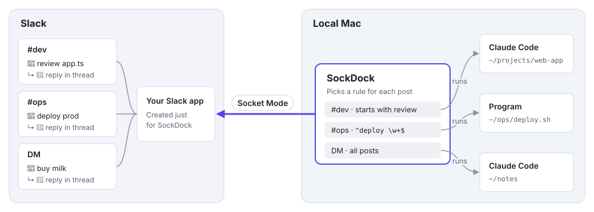

# SockDock for Slack

**Run Slack apps locally: one Socket Mode connection, many handlers.**

[日本語](README.ja.md)

SockDock (`sockdock`) is a small gateway that runs on your Mac. It receives messages from your Slack workspace over [Socket Mode](https://docs.slack.dev/apis/events-api/using-socket-mode/) — nothing needs to be reachable from the internet — and hands them to handlers you configure:

- **command** handlers: any program. It gets the message as JSON on stdin; its stdout is posted back to the thread.
- **claude** handlers: [Claude Code](https://code.claude.com/) in headless mode. Each Slack thread is one conversation that continues on every reply, limited to the tools you allow.

Think of it as a power strip: Slack apps allow one socket, and SockDock lets you plug many things into it. A top-level message that matches a route (a channel, or DMs to the app, plus a condition) starts a thread; every reply in that thread goes to the same handler.

<picture>
  <source media="(prefers-color-scheme: dark)" srcset="assets/architecture-dark.svg">
  
</picture>

It comes with a CLI and an optional menu bar app.

> SockDock is not affiliated with, created by, or supported by Slack Technologies, LLC.

**Status:** early development. macOS 13+ is the main target (the CLI also works on Linux).

## Quick start

### 1. Install

With [Homebrew](https://brew.sh/):

```bash
brew install --cask iwamatsu0430/tap/sockdock   # menu bar app
brew install --formula iwamatsu0430/tap/sockdock # CLI (macOS, Linux)
```

The app is not notarized by Apple, so the first time you open it, macOS stops it with “SockDock” Not Opened:

1. Click **Done** (not Move to Trash).
2. Open **System Settings → Privacy & Security**, scroll down and click **Open Anyway**.
3. When asked again, click **Open**. From then on it opens normally.

This allows SockDock only; the rest of your Mac's protection stays on. Homebrew checks the download against the checksum recorded in the tap before installing it. See also [Safely open apps on your Mac](https://support.apple.com/en-us/102445).

Or build from source. Tools are managed with [mise](https://mise.jdx.dev/).

```bash
git clone https://github.com/iwamatsu0430/sock-dock-slack.git
cd sock-dock-slack
mise install          # Go, Node, wails3
mise run build        # -> bin/sockdock
mise run app          # optional: -> dist/SockDock.app (menu bar app, CLI bundled)
```

If you built it, put `bin/sockdock` somewhere on your `PATH` (the examples below assume `sockdock` is on it).

### 2. Create the Slack app

```bash
sockdock manifest
```

1. Open <https://api.slack.com/apps?new_app=1>, choose **From a manifest**, and paste the manifest.
2. **Basic Information → App-Level Tokens**: generate a token with the `connections:write` scope (`xapp-…`).
3. **Install App**: install it to your workspace and copy the **Bot User OAuth Token** (`xoxb-…`).
4. Invite the bot to every channel you want to route from: `/invite @SockDock`. DMs to the app need no invite.

Optional: to show SockDock's icon on its replies, upload [`assets/slack-icon.png`](assets/slack-icon.png) as the app icon (**Basic Information → Display Information**). Slack manifests can't set it.

### 3. Store the tokens

```bash
sockdock auth set     # prompts for both tokens and stores them in the macOS Keychain
sockdock auth status
```

Alternatively, export `SLACK_APP_TOKEN` and `SLACK_BOT_TOKEN`, or point `settings.secrets_file` at a `chmod 600` `.env` file.

### 4. Configure routes

```bash
sockdock init         # writes a starter config with an "echo" route
mkdir -p ~/sockdock-handlers
cp examples/echo.sh ~/sockdock-handlers/   # the handler that route runs
```

Edit the config and replace `C0123456789` with your channel's ID.

The config lives at `~/Library/Application Support/sockdock/config.yaml` (Linux: `$XDG_CONFIG_HOME/sockdock/config.yaml`). A minimal route:

```yaml
routes:
  - name: echo
    channel: C0123456789            # channel ID (channel details → bottom of the About tab)
    starts_with: echo               # posts that start with "echo"
    handler:
      type: command
      cwd: ~/sockdock-handlers
      command: ["./echo.sh"]
```

A route reacts to top-level posts that meet one of these conditions. Within a channel, routes are tried from the top and the first match runs (routes that are off are skipped).

| Key | Posts it runs on | `groups` |
|---|---|---|
| `starts_with: echo` | Posts starting with the keyword | `text`: what follows the keyword |
| `contains: review` | Posts containing the keyword | `text`: the whole post |
| `match: '^deploy (?P<env>\w+)$'` | Posts matching the regular expression (RE2) | the named groups |
| `all_posts: true` | Every post | `text`: the whole post |

Keywords ignore case, full-width vs half-width characters, repeated spaces and a leading mention of the Slack app. A keyword of letters and digits does not match inside a word (`entry` does not match `entryx`). Regular expressions are case sensitive. Add `mention_only: true` to run a route only for posts that mention the Slack app, and use `channel: dm` for DMs (see "DMs and mentions" below).

Check it:

```bash
sockdock check
sockdock match C0123456789 "echo hello"
```

### 5. Run

```bash
sockdock run                # in the foreground (Ctrl-C to stop)
sockdock service install    # or, without the menu bar app: start at login, restart on failure (launchd / systemd)
sockdock status
```

Post `echo hello` in the channel: SockDock reacts with 👀, runs the handler and replies in the thread.

### Or use the menu bar app

With the app you do not need steps 3–5 above or any YAML. Open SockDock from Applications (built from source: `open dist/SockDock.app` or `mise run gui`):

1. **Setup** (first launch): *Open api.slack.com* opens Slack's "create an app" page with the manifest filled in. Install the app, generate an App-Level Token with `connections:write`, then paste both tokens and press **Connect to Slack**. The tokens are checked with Slack first and saved to the Keychain only if both work. To use a Slack app you already have, open **Use a Slack app you already have** in setup: it lists the settings (Socket Mode, the `message.channels`/`message.groups` events, Bot Token scopes, for DMs the optional `message.im` event, `im:history` scope and Messages tab, and for attached files the optional `files:read` scope) and copies the part to add to its App Manifest. With Socket Mode on, that app's events go only to SockDock. If required scopes are missing, **Connect to Slack** names them.
2. **Rules → Add Rule**: pick the channel (channels the Slack app has been added to are listed; without the `channels:read`/`groups:read` scopes, enter a channel ID or link) or **DM**, choose who can run it (everyone in the channel, or people you choose by name), choose which posts it reacts to (starting with, containing, a regular expression, or all; tick *Only when mentioned* to need a mention of the Slack app), and choose what runs — an AI agent (Claude Code) in a working folder, with instructions and what it may do, or a program. The list is grouped by channel and shows each rule's last run. Within a channel the rule higher up comes first; drag ⠿ to reorder. Open a rule for recent runs, thread links and **Stop**.
3. Post something like `<keyword> …` in the channel.

The app runs the gateway while it is open — there is no separate service to install. Clicking the menu bar icon shows the connection, running and recent runs; There is one window: switch between **Rules** and **Settings** at the top. **Settings** (⌘,) has the Slack connection and who you are in Slack (see "Notifications by DM"), *Open at login*, notifications (Mac and Slack DM), the language (also used for the messages posted to Slack), MCP and **Reset SockDock…**, which removes the tokens, rules, run history and app settings and starts over from setup (the config file goes to the Trash; logs are kept). **Open Config File** opens the YAML in your editor for anything the form does not cover. A rule with a problem (e.g. a missing folder, or a rule above that always matches first) is shown in red and left out; the other rules keep running.

If a `sockdock service install` service is already running, the app shows its state and does not start its own gateway.

## Who can run a rule

Anyone who can post in a channel can trigger its rules. To limit a rule to some people, list their Slack member IDs:

```yaml
routes:
  - name: deploy
    channel: C0123456789
    starts_with: deploy
    allowed_users: [U0123ABCD, U0456EFGH]
    handler: { type: command, cwd: ~/ops, command: ./deploy.sh }
```

- Posts and thread replies from anyone else are ignored: no 👀, no reply, and they never reach the handler. A rule further down the channel can still pick up their post.
- In the app, open the rule, set **Who Can Run It** to **Chosen People** and add people by name. Choosing by name needs the `users:read` scope, which the bundled manifest includes. If you created your Slack app earlier, add `users:read` to its Bot Token scopes and reinstall it; until then you can enter member IDs (in Slack, a profile's ⋮ menu → **Copy member ID**). `users:read` lets the app read the profiles of the workspace's members; SockDock uses it only for this list.
- An agent rule that is open to everyone and may run commands or edit files shows a warning in the app.

## Handlers

Every handler receives this JSON (on stdin for command handlers):

```json
{
  "route": "echo",
  "turn": 1,
  "channel": "C0123456789",
  "thread_ts": "1762920000.000100",
  "permalink": "https://example.slack.com/archives/C0123456789/p1762920000000100",
  "groups": { "text": "hello" },
  "messages": [{ "ts": "1762920000.000100", "user": "U0123", "text": "echo hello" }]
}
```

`groups` holds the values taken from the first message (see the table above) and is passed on every turn of the thread.

### Attached files

Files attached to a post or a thread reply (screenshots, logs, PDFs, …) are handed over with it, so you can ask "look at this screenshot". A message with files gets a `files` list:

```json
"messages": [{ "ts": "1762920000.000100", "user": "U0123", "text": "check this log",
  "files": [
    { "name": "app.log", "mimetype": "text/plain", "size": 18233, "path": "/Users/me/Library/Caches/sockdock/files/812/app.log" },
    { "name": "build.zip", "mimetype": "application/zip", "size": 73400320, "skipped": "too_large" }
  ] }]
```

- The files are saved for this run only (in `~/Library/Caches/sockdock/files/`, outside the rule's folder) and deleted when it ends. Copy them if you need them later.
- A file that is not handed over has `skipped` instead of `path`: `too_large` (over `settings.max_file_mb`, 20 MB by default), `external` (stored outside Slack, e.g. Google Drive), `unsupported` (Slack posts and canvases), `no_scope` (the Slack app lacks `files:read`) or `failed`. The run goes ahead with the text and the other files; SockDock posts nothing about it, so the handler decides whether to mention it.
- Only files of posts that start or continue a run are fetched. Posts from people a rule does not allow are never fetched.
- This needs the `files:read` Bot Token scope, which the bundled manifest includes. If you created your Slack app earlier, add `files:read` and reinstall the app; until then the rule's recent runs say the files were not passed on. `files:read` can read files in the channels and DMs the Slack app is in; SockDock reads only the files of posts that run a rule.
- File contents are untrusted input, just like the post text: a screenshot or a log can contain instructions aimed at the agent.

### command

```yaml
handler:
  type: command
  cwd: ~/my-handlers
  command: ["uv", "run", "python", "bot.py"]   # no shell is involved
  env_file: .env                                # optional, relative to cwd
  timeout_sec: 300
```

- stdout is posted to the thread (nothing is posted if it is empty).
- Environment: `SLACK_CHANNEL`, `SLACK_THREAD_TS`, `SOCKDOCK_ROUTE`, `SOCKDOCK_TURN`, plus `env_file`/`env`. Slack tokens are never passed: the reply is whatever the handler prints.
- A non-zero exit or a timeout posts a short error; stderr goes to the log only.

### claude

```yaml
handler:
  type: claude
  cwd: ~/projects/my-project
  prompt: prompts/slack.md                   # appended to the system prompt every turn
  allowed_tools: ["Bash(make test *)", "WebSearch", "WebFetch"]
  model: opus
  timeout_sec: 600
```

- Runs `claude -p --output-format json --permission-mode dontAsk` with your `allowed_tools`; anything else that needs approval is denied. Read, Glob and Grep are available; MCP tools are off unless `allow_mcp: true`.
- Each thread keeps its session and resumes it on the next reply. If it cannot be resumed, a new conversation starts and the thread is told so.
- Messages that arrive while Claude is working are handed over together in the next turn.
- Attached files are listed in the prompt with their paths, and for that turn the agent may read their folder (`Read(//…/**)` is added to the allowed tools). Claude Code's Read shows images and PDFs too. Files from earlier turns are gone, but what the agent read stays in the conversation.
- Claude Code uses your own login. Because `--bare` is not used, the project's `.claude/settings.json`, `CLAUDE.md` and hooks apply too — take them into account when deciding what a route may do.
- Set `settings.claude_command` to an absolute path: version-manager shims (mise, asdf, …) often fail when SockDock starts Claude Code. The menu bar app gives handlers your login shell's `PATH`; `sockdock service install` records the `PATH` it was run with.

## DMs and mentions

A rule can react to DMs sent to the Slack app instead of a channel's posts, and a channel rule can require a mention of the app:

```yaml
routes:
  - name: todo
    channel: dm                 # DMs to the Slack app, from anyone allowed below
    starts_with: todo
    allowed_users: [U0123ABCD]
    handler: { type: claude, cwd: ~/notes }

  - name: review
    channel: C0123456789
    starts_with: review
    mention_only: true          # only "@SockDock review …"; plain "review …" does nothing
    handler: { type: claude, cwd: ~/projects/web-app }
```

- DMs work like channel posts: a top-level DM starts a thread, SockDock replies in it, and replies in that thread continue the conversation. DM rules are tried from the top like a channel's.
- Without `allowed_users`, anyone in the workspace can run a DM rule. In the app a new DM rule starts limited to you (see "Notifications by DM").
- A mention in the middle of a thread never starts a rule; only top-level posts do.
- DMs need the App Home **Messages tab** (with sending messages allowed), the `im:history` Bot Token scope and the `message.im` event. The bundled manifest has them. If you created your Slack app earlier, add them and reinstall the app; the rule page and Settings say when `im:history` is missing. `im:history` reads only DMs sent to the Slack app. Mentions need nothing new.

## Notifications by DM

SockDock can also send its notices to you as Slack DMs, not only as Mac notifications. Register who you are in Slack once:

1. In the app, **Settings → Slack → Register Yourself** (or `sockdock owner register`). A six-digit code appears; it changes every 30 seconds. **Copy** copies it.
2. Send that code to the Slack app as a DM. If it matches, the sender is registered and gets "✅ You're registered."

Codes are accepted for 10 minutes after you start, and five wrong codes end it. If the wrong person got registered, press **Remove** and register again. Settings shows your name when the Slack app has `users:read`; without it, your member ID.

**Settings → Notifications** has a switch for the Mac and one for Slack DMs. By DM you get: Claude Code being signed out (once, until it is signed in again) and rules changed through MCP. Turn on *Also send failed runs* to get a DM for every failed run too (there can be many). In the config these are `settings.owner`, `settings.notify_dm` and `settings.notify_dm_failures`.

## Updates

SockDock checks GitHub for a newer release when it starts and once a day, and tells you once per version: a Mac notification and a Slack DM (each follows its switch in **Settings → Notifications**). While a newer version is out, the menu bar menu has **Update to SockDock 0.2.0…**: it shows the release notes in your language, then **Update** opens Terminal and runs `brew upgrade --cask iwamatsu0430/tap/sockdock`, which quits the app and opens it again when done. If a rule is running, the dialog says that updating stops it.

Turn the check off in **Settings → General → Check for Updates** (`settings.check_updates: false`). Only the request to GitHub leaves your Mac; tokens, settings and rules are not sent. Builds from source never check. Without the app, `sockdock status` shows a newer version.

## Configuration reference

```yaml
settings:
  max_concurrency: 3        # handlers running at the same time (restart to change)
  thread_ttl_days: 30       # how long a thread stays bound to its route
  max_file_mb: 20           # larger attached files are not handed over
  ack_reaction: eyes
  claude_command: claude    # string or list; per-route `command` overrides it
  language: auto            # canned replies posted to Slack: auto, en, ja
  path: ["/opt/homebrew/bin"]
  secrets_file: secrets.env
  messages:                 # override canned replies; placeholders {route} {timeout_sec}
    timeout: "Timed out after {timeout_sec}s."
  owner: U0123ABCD          # you, registered with a code (sockdock owner register)
  notify_dm: true           # notices by Slack DM to the owner
  notify_dm_failures: false # also a DM for every failed run
  check_updates: true       # look for a newer SockDock once a day
```

- `${VAR}` in a route is read from its `env_file`, then from the environment.
- Unknown keys are rejected, so typos show up in `sockdock check`.
- Reload a changed config with `sockdock reload` (or `SIGHUP`, or saving in the app).

## CLI

| Command | |
|---|---|
| `sockdock run` | Run the gateway in the foreground |
| `sockdock init` / `check` / `match` | Create, validate and test the config (`match dm "<text>"` tries a DM; `--mention` a post that mentions the app) |
| `sockdock owner` / `owner register` / `owner clear` | Show, register or remove who gets notices by DM |
| `sockdock status` | Gateway status, and a newer version if one is out (exit code 1 if not running or not connected) |
| `sockdock reload` | Re-read the config |
| `sockdock threads` / `turns` / `logs` | Recent threads, handler runs and log lines |
| `sockdock pause <route>` / `resume <route>` | Pause or resume a route |
| `sockdock auth set` / `status` / `delete` | Manage tokens in the Keychain |
| `sockdock service install` / `uninstall` / `status` | Background service for use without the menu bar app (launchd / systemd) |
| `sockdock manifest` | Print the Slack app manifest |
| `sockdock mcp` | Serve MCP over stdio (see "MCP" below) |

Files: data and the control socket are in `~/Library/Application Support/sockdock/`, logs in `~/Library/Logs/sockdock/`, attached files (only while a run uses them) in `~/Library/Caches/sockdock/files/`.

## MCP

While SockDock runs (the app or `sockdock run`), MCP clients such as Claude Code and Codex can control it — e.g. "add a rule that runs Claude Code in ~/app for posts in #ask".

The easiest way to register it is **Settings → MCP** in the app: pick your client and copy. To register by hand (`<sockdock>` is the CLI's absolute path; in the app, `SockDock.app/Contents/MacOS/sockdock`):

| Client | Register with |
|---|---|
| Claude Code | `claude mcp add -s user sockdock -- <sockdock> mcp` |
| Codex | `codex mcp add sockdock -- <sockdock> mcp` |
| Gemini CLI | `gemini mcp add -s user sockdock <sockdock> mcp` |
| VS Code | `code --add-mcp '{"name":"sockdock","command":"<sockdock>","args":["mcp"]}'` |
| Claude Desktop | in the app, **Settings → MCP**, choose Claude Desktop and press **Add to Claude Desktop** (it builds and opens the `SockDock.mcpb` extension) |
| Cursor / others | add `"sockdock": {"command": "<sockdock>", "args": ["mcp"]}` to `mcpServers` in its config file |

The tools show the status, rules, recent runs and channels, test which rule a post would hit, find people by name for who can run a rule, add, change, delete, reorder and turn rules on or off, and stop runs.

- A rule changed through MCP raises a notification on the Mac (even with notifications off), and a DM when notices by DM are on.
- MCP cannot register or remove the owner.
- Tokens and post texts are never passed to MCP.
- `sockdock mcp` refuses to start inside a run started by SockDock (an agent answering a Slack post).

See [docs/mcp.md](docs/mcp.md) for details.

## Development

```bash
mise tasks            # list tasks
mise run ci           # vet, tests, frontend type check
mise run gateway      # build and run the gateway
mise run gui          # build and open SockDock.app
mise run gui-preview  # the GUI in a browser at http://localhost:8080 (no tray)
mise run preview      # the same against a fake Slack, with sample rules; real data untouched
```

`mise run preview` (`scripts/preview.sh`) keeps its data in `~/.cache/sockdock-preview`. `PREVIEW_RESET=1` starts over, `PREVIEW_NO_IM=1` plays a Slack app without `im:history`, `PREVIEW_NO_UPDATE=1` hides the fake newer version (v0.2.0) it otherwise offers, and `curl 'http://127.0.0.1:8766/dm?text=…'` sends a DM from the fake person.

To keep development away from your real config, set `SOCKDOCK_DATA_DIR` and `SOCKDOCK_CONFIG` (see the `[env]` section of `mise.toml`).

Layout: `cmd/sockdock` (CLI), `internal/` (gateway, handlers, control API, …), `gui/` (Wails v3 + Svelte), `examples/` (sample handlers), `scripts/` (app bundling, also usable without mise), `docs/` (design notes, in Japanese).

## License

[MIT](LICENSE)
